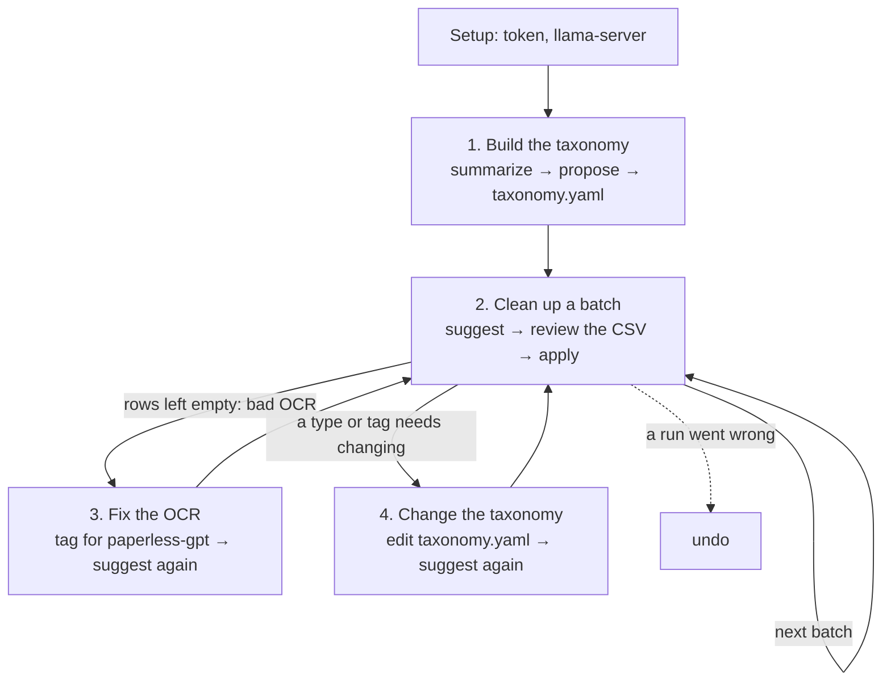
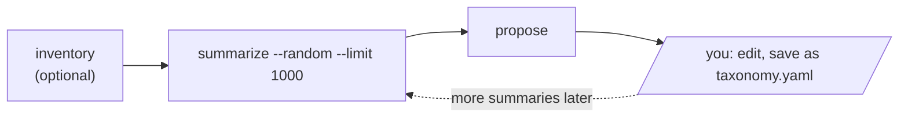
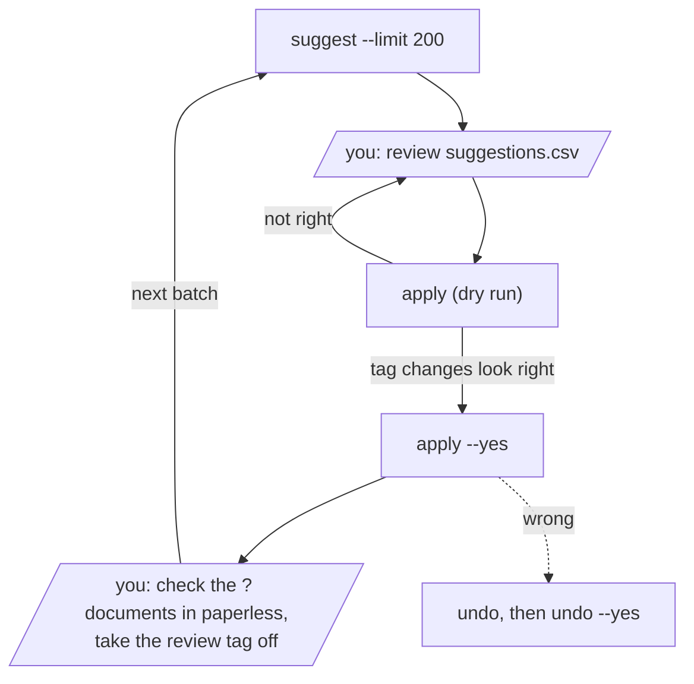
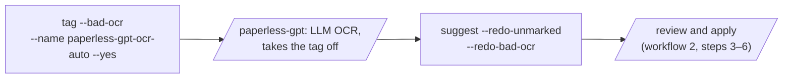
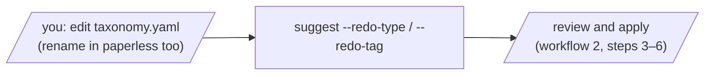
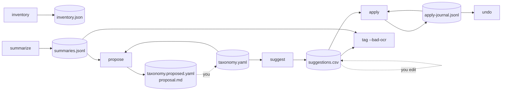

# paperless metadata tools

`metadata.py` cleans up paperless's titles, document types, correspondents, tags and custom fields with the local LLM on the NAS (`llama-server`, see [`docker/nas/10-llama`](../../../../../docker/nas/10-llama/README.md)). Documents go from paperless to `llama.${DOMAIN_APP}` and nowhere else. The results land in `~/paperless-metadata` (mode `0700`), outside this repo: they hold document titles and names, and the repo is public.

Nothing here is deployed: Flux only applies `../app`.

## Setup

1. Create an API token in paperless (profile menu → My Profile → API Auth Token) and store it in 1Password as `API_TOKEN` on the `paperless` item.
2. Start the chat server if it isn't running: `just docker llama-start`.
3. Export the token for the shell you run the script from:

   ```bash
   export PAPERLESS_TOKEN=$(op read op://homelab/paperless/API_TOKEN)
   ```

Run every step as `kubernetes/apps/default/paperless/tools/metadata.py <step>` (it runs through `uv`); below it is shortened to `metadata.py <step>`.

**Dry runs.** `apply`, `undo` and `tag` change paperless only with `--yes`. Without it they print what they would do: run each without `--yes` first and read the output.

**Options before the step** (`metadata.py --debug suggest --ids 3760`):

| Option              | Environment     | Default                               |
| ------------------- | --------------- | ------------------------------------- |
| `--paperless URL`   | `PAPERLESS_URL` | `https://paperless.${DOMAIN_CLUSTER}` |
| `--llm URL`         | `LLM_URL`       | `https://llama.${DOMAIN_APP}/v1`      |
| `--model NAME`      | `LLM_MODEL`     | `Qwen3.6-35B-A3B`                     |
| `--out DIR`         | `METADATA_OUT`  | `~/paperless-metadata`                |
| `--debug`           |                 | off                                   |
| `--debug-file FILE` |                 | implies `--debug`                     |

`--debug` writes every request to the model, and its reply, to `~/paperless-metadata/debug-<time>.log`, one file per run; `--debug-file FILE` picks the file (and appends to it). The terminal only says where the log is. It holds the system prompt and every text part verbatim, in the order they are sent, each page image as a placeholder with its size, and the JSON schema the answer must follow. It holds document text, so the file is created readable only by you; keep it on your machine.

## Workflows



Workflow 1 runs once, workflow 2 once per batch until every document is done, and the others when they're needed.

### 1. Build the taxonomy



1. **Optional:** `metadata.py inventory` writes `inventory.json`, the current types, tags, correspondents, storage paths and custom fields with document counts, for you to read. No other step reads it: each fetches what it needs from paperless.
2. `metadata.py summarize --random --limit 1000` describes a random sample of 1000 documents (about two hours). Newest first would leave out the kinds of documents and senders that only older documents have. Run it again for another random batch: it skips documents that already have a summary.
3. `metadata.py propose` writes `taxonomy.proposed.yaml` and `proposal.md`. `proposal.md` explains the proposal, and lists the unclear documents and the IDs whose OCR was rated `slecht`.
4. Edit the proposal and save it as `taxonomy.yaml` (see [`taxonomy.yaml`](#taxonomyyaml)). That file is the convention: `suggest` can only pick what it lists.

`propose` can run again after more summaries; it then builds on `taxonomy.yaml` (see [Proposing again](#proposing-again)).

### 2. Clean up a batch



1. **Before the first real `apply`**, take a database backup: `just k8s db-backup default paperless`.
2. Close `suggestions.csv` in your spreadsheet, then run `metadata.py suggest --limit 200` (roughly half an hour). It adds a row per document to the CSV, newest documents first, and continues where the last run stopped. The `apply` cell of each new row is pre-marked (see [Marks](#marks-in-suggestionscsv)).
3. Review the new rows in a spreadsheet: spot-check the `x` rows, edit cells that are wrong, and change any mark you disagree with.
4. `metadata.py apply` (a dry run) prints each document's changes, tags included (`tags -[removed] +[added]`). The first time, try a few: `apply --limit 5 --yes`, and check those documents in paperless.
5. `metadata.py apply --yes` writes the rest of the marked rows. Rows an earlier run wrote are skipped, so earlier batches' marks are safe to leave in the CSV.
6. In paperless, filter on the review tag (`review_tag`, a saved view on the dashboard helps), check each `?` document against its scan, fix what's wrong, and take the tag off.
7. Next batch: back to step 2.

Rows left empty because the OCR is rated `slecht` are guesses: fix the OCR first (workflow 3). When the CSV has no unchecked rows left and nothing has the review tag, delete it: `metadata.py tag --name <review_tag> --remove --yes`.

A run that went wrong: `metadata.py undo` shows what it would restore, `undo --yes` restores it (see [Undo and backups](#undo-and-backups)).

### 3. Fix the OCR



The new text comes from paperless-gpt's LLM OCR (GLM-OCR, see [`../../README.md`](../../README.md)), not from paperless. **Don't use Reprocess in paperless:** it runs paperless's own OCR and overwrites any text paperless-gpt wrote, whatever `PAPERLESS_OCR_MODE` says.

1. `metadata.py tag --bad-ocr --name paperless-gpt-ocr-auto` (a dry run) counts the documents rated `slecht`, and names any that are no longer in paperless; those are skipped. The rating comes from the CSV's `ocr` column, your edits included, and from `summarize` for documents the CSV doesn't rate yet (see [OCR ratings](#ocr-ratings)). `--ids 12,34` instead of `--bad-ocr` tags documents you name.
2. The same with `--yes` puts paperless-gpt's OCR trigger tag on them. paperless-gpt reads every page, writes the text into the document's content, takes the trigger tag off and adds `paperless-gpt-ocr-complete`. It skips a document that already has `paperless-gpt-ocr-complete`: a `slecht` rating there means the LLM text is poor too. Remove that tag first to OCR it again.
3. Wait until no document has `paperless-gpt-ocr-auto` any more. `paperless-gpt-failed` marks the ones whose OCR failed.
4. Close the CSV, then `metadata.py suggest --redo-unmarked --redo-bad-ocr` suggests again for every row whose `apply` cell is empty or whose `ocr` is `slecht`, now from the new text. Both flags are needed: a row the model was sure about gets an `x` even with bad OCR, and `--redo-unmarked` alone would keep its old rating.
5. Review and apply the redone rows as in workflow 2, steps 3–6. A document an earlier `apply` already wrote is skipped: `apply --ids 12,34 --reapply --yes` writes it again.
6. If you'll run `propose` again: `metadata.py summarize --redo --ids <the IDs proposal.md lists>`.

The `Redo OCR` tag (`tag` without `--name`) is for selecting documents in paperless's UI by hand; `tag --remove --yes` deletes it again. Don't `--remove` paperless-gpt's tags.

### 4. Change the taxonomy



1. Edit `taxonomy.yaml`. To rename a type or tag that documents already have, rename it in paperless as well: the documents follow it there, and `apply` would otherwise create the new name next to the old one.
2. Close the CSV, then suggest again for the rows the change affects, for example `metadata.py suggest --redo-type Factuur,Brief` or `--redo-tag Aankopen`. Names match what the row suggests, so a name you've since renamed or removed still finds its rows. Before it starts, `suggest` says how many rows it picked and how many of their documents an earlier `apply` already wrote (see [Suggesting again](#suggesting-again)).
3. Review and apply as in workflow 2, steps 3–6. Documents an earlier run wrote are skipped: write them with `apply --ids … --reapply`. `--reapply` on its own writes every marked row again, overwriting what you've fixed in paperless since.
4. A new type that should be filed differently gets a storage path and a workflow in paperless (see [paperless file names](../../README.md)); the script never sets storage paths.

## Steps

| Step        | What it does                                                                                                                            | Writes                                      |
| ----------- | --------------------------------------------------------------------------------------------------------------------------------------- | ------------------------------------------- |
| `inventory` | Exports types, tags, correspondents, storage paths and custom fields, with document counts. No document content.                        | `inventory.json`                            |
| `summarize` | The LLM describes each document: one-line summary, kind, sender, life domains, language. Newest first.                                  | `summaries.jsonl`                           |
| `propose`   | Turns the summaries into a proposed taxonomy: at most 25 types, 15 domain tags, advice per existing tag, and correspondent name groups. | `taxonomy.proposed.yaml`, `proposal.md`     |
| `suggest`   | Per document: title, one type, correspondent, 1–4 domain tags and the custom fields, constrained to `taxonomy.yaml`. Newest first.      | `suggestions.csv`                           |
| `apply`     | Writes the marked rows. A dry run unless `--yes`.                                                                                       | `apply-journal.jsonl`, changes in paperless |
| `undo`      | Restores what an apply run changed. A dry run unless `--yes`.                                                                           | changes in paperless                        |
| `tag`       | Puts a temporary tag (`Redo OCR` unless `--name`) on `--bad-ocr` or `--ids` documents; `--remove` deletes it. A dry run unless `--yes`. | a tag in paperless                          |

What each step reads and writes in `~/paperless-metadata` (every step also talks to paperless, and `summarize`, `propose` and `suggest` to the LLM):



`summarize` and `suggest` take `--limit N`, `--query '<paperless search>'` and `--ids 1,2,3`, and resume where they stopped: run them again to continue. `summarize --redo` describes documents again; the newest summary of a document wins.

## Marks in `suggestions.csv`

`x` in the `apply` cell writes a row, `?` writes it and tags the document for review, empty skips it. `suggest` fills the cell of each new row:

| Mark  | When                                                                                                                                | What `apply` does                                    |
| ----- | ----------------------------------------------------------------------------------------------------------------------------------- | ---------------------------------------------------- |
| `x`   | `confidence` is `hoog` and the correspondent needs no check (`correspondent_status` isn't `nieuw: controleren` or `controleren: …`) | writes the row                                       |
| `?`   | anything else with readable OCR, when `taxonomy.yaml` has a `review_tag`                                                            | writes the row and puts `review_tag` on the document |
| empty | OCR rated `slecht` (the suggestion is a guess), or no `review_tag`                                                                  | nothing                                              |

`suggest --no-mark` leaves every cell empty. A `?` row is quicker to check in paperless than in the spreadsheet, with the scan next to the metadata. `apply` never removes the review tag, and paperless never adds it by itself (no matching).

## Suggesting again

For documents already in the CSV, after a change to `taxonomy.yaml` or the OCR:

| Option                         | Rows                                                                                    |
| ------------------------------ | --------------------------------------------------------------------------------------- |
| `--redo --ids …` / `--query …` | the documents you name                                                                  |
| `--redo-unmarked`              | every row whose `apply` cell is empty                                                   |
| `--redo-bad-ocr`               | every row whose `ocr` cell is `slecht`, whatever its mark                               |
| `--redo-type Factuur,Brief`    | every row whose suggested `type` is one of these, whatever its mark                     |
| `--redo-tag Aankopen`          | every row whose suggested `tags` (labels included) hold one of these, whatever its mark |

The last four combine (a row matching any of them is redone), take `--limit`, and can't be combined with `--ids` or `--query`. Names match case-insensitively on what the row suggests, so a type or tag you've since renamed or removed from `taxonomy.yaml` still finds its rows. Before it starts, `suggest` says how many rows it picked, per mark, and how many of their documents an earlier `apply` already wrote: apply skips those unless `--reapply`.

The new row takes the place of the old one, with a fresh mark, and the file before goes to `suggestions.csv.bak`. A cell you edited in a redone row is lost. Close the CSV in your spreadsheet before running `suggest`.

## Proposing again

Once `taxonomy.yaml` exists, `propose` builds on that file:

- **Kept unchanged:** its types, domain tags and correspondent groups, in their order, and every other setting.
- **New types and domains** are added at the end.
- **A new spelling** becomes an alias of the group it resembles.
- **Tag advice** covers only tags the file doesn't mention yet.
- **`ignore`:** names listed there are never proposed again.

`proposal.md` lists what is new. `propose` still writes only `taxonomy.proposed.yaml`: compare it with `diff taxonomy.yaml taxonomy.proposed.yaml` and copy over what you want.

## What the LLM sees

Every prompt is structured with XML-style tags. The instructions are plain text in `<taak>` and `<velden>` (one line per field of the answer, in the order the model writes them), and each list to choose from has its own tag (`<documentsoorten>`, `<domeinlabels>`, `<regels_domeinlabels>`, `<eigenschapslabels>`, `<extra_velden>`, `<correspondenten>`), so the instructions can name them. The document material follows in `<huidige_gegevens>`, `<bestandsnaam>`, one `<pagina>` per image with that page's `<ocr>`, and `<document>`. The system prompt says everything in those last tags is material, not instructions, and `<` and `>` in that material become `‹` and `›`, so a document can't close its tag and pose as one. The fixed part comes first, so llama.cpp's prompt cache covers it. `--debug` shows the whole prompt.

The first 3000 (`summarize`) or 6000 (`suggest`) characters of paperless's OCR text, and the original filename, flagged as often meaningless (scanner and download names). Never the PDF's own metadata: on a home scan its author and producer are the printer.

**Page images.** Qwen3.6 reads images (its preset has a vision projector, see [`docker/nas/10-llama`](../../../../../docker/nas/10-llama/README.md)), so both steps can also send pages of the document as images. An image roughly doubles the time per document, so `--images auto` (the default) sends them only where they help:

1. **Straight away** when the OCR text alone is clearly not enough: an image file (a photo), fewer than 100 characters per page, or fewer than 65% of the words looking like words (3 or more letters with a vowel; OCR garbage such as "Gar ge Vo rb ld" fails that). These checks take no model time.
2. **Otherwise text only first**, and the same document again with the image when that answer is weak: OCR rated `slecht`, no sender, and for `summarize` a `duidelijkheid` other than `duidelijk`, for `suggest` `confidence: laag`.

The thresholds come from this archive's text-only OCR ratings: the first check flagged 58% of the documents rated `slecht`, 15% of `matig` and 14% of `goed`, most of those with no text at all, which a text-only rating can't judge anyway. The second catches the rest of `slecht`, and the letterhead-only senders no text check can see. What neither catches is a document the model reads wrongly but confidently from the text: keep spot-checking. `--images always` sends them for every document, `--images never` (or `--image-pages 0`) never.

**Which pages.** Never a random choice or a share of the pages: the same document always gets the same pages, and a long manual's page 30 adds nothing its page 1 doesn't. At most `--image-pages` (default 3), by why the document gets images:

| Why                                                   | Pages                                                                                                                                    |
| ----------------------------------------------------- | ---------------------------------------------------------------------------------------------------------------------------------------- |
| any                                                   | page 1: letterhead, logo, type, date, title                                                                                              |
| bad OCR (photo, little text, garbled, rated `slecht`) | + the page whose OCR text scores worst on the same checks, if it fails them, so the OCR rating covers the worst part                     |
| no sender, unclear, `confidence: laag`                | + page 2 of a 2-page document (often the back of a card or licence), or the last page of a longer one (signature, stamp, issuer, totals) |

A blank page (no text, hardly any ink: the empty back of a duplex scan) is never picked, page 1 included. paperless's own text runs the pages together, so the script reads the text per page from the PDF's text layer, which holds the same OCR text, and sends each image with its page number and that page's OCR text: the prompt otherwise only holds the first `--chars` characters, too few to judge a later page. Where paperless's text and the layer differ (paperless-gpt's LLM OCR replaces the first, not the PDF), the layer's text stays out and the model compares with the start of the content. The OCR rating is the worst page's.

The script downloads the document and renders the pages on your machine at 110 DPI (`--image-dpi`; raise it for small print), capped at 3 million pixels so a drawing or poster goes smaller; each extra page adds about 4–5 seconds. The model is told to use the pages for what the OCR text misses or misreads (letterhead, logo, layout, tables, stamps, handwriting, photos) and to take nothing from it that it can't read there either. The images sit between the fixed instructions and the document text, so llama.cpp still caches the instructions. A document that can't be rendered goes without an image; a model that rejects images makes the rest of the run go without them. `summaries.jsonl` records how many images each summary had and why (`image_reason`), and `proposal.md` counts them; both steps log the reason per document.

**Unclear documents.** `summarize` rates `duidelijkheid`: how clear it is what the document is and who sent it (`duidelijk`, `deels`, `onduidelijk`), before it writes the summary, which follows from it: an unclear document's summary starts with `Onduidelijk:` and only describes what is visible, a partly clear one says what is uncertain ("Waarschijnlijk een factuur van …"), with no type, sender or subject made up. `proposal.md` lists the unclear documents to look at yourself. `suggest` has no such field, but its summary gets the same `Onduidelijk:` rule and its `confidence` turns `laag`.

`suggest` also sees the document's current title, type, correspondent and tags, described as possibly correct and useful but possibly stale, incomplete or wrong. The model keeps what the content confirms or makes plausible and drops what contradicts it; when the content itself is unclear, the current values may decide, and it answers `confidence: laag` if only they support its answer. `--ignore-current` leaves them out. `summarize` never sees them, so the taxonomy proposal rests on the documents alone; `propose` sees only the names and counts of the existing types and tags, to reuse names that fit.

The sender (`afzender`, `correspondent`) is the organisation that wrote or issued the document: the letterhead, or for a licence, card, diploma or certificate the issuing body. Never the holder, recipient or someone who only signs. When that isn't clear, it's left empty rather than guessed.

### OCR ratings

`summarize` and `suggest` also rate the OCR (`goed`, `matig`, `slecht`). With the page image the model compares the OCR text with the page: `goed` means all readable text of the page is in it, `matig` clear errors or a missing part, `slecht` mostly unreadable or mostly missing. Empty OCR text on a page with even a few readable words is `slecht`, and a page without any text, such as a photo, with empty OCR text is `goed`; the prompt says empty OCR text out loud, as a model reads an empty section as a page without text. It only judges the page it sees, not the rest of the document. Without an image it is the model's impression of the text alone, and a page of numbers or tables can look worse than it is. `proposal.md` lists the IDs rated `slecht`; `suggest` rates the OCR again in its `ocr` column. That rating is the one `tag --bad-ocr` goes by, edits included: it has seen twice the text, maybe page images, and it is refreshed after reprocessing. `summarize`'s rating only counts for documents the CSV has no rating for. [Fix the OCR](#3-fix-the-ocr) has the steps to reprocess the `slecht` ones.

## Timing

About 11 seconds per document on the NAS with the page image, 5–7 without. With `--images auto` most documents go without, and a weak one costs both, so a pass over 4,000 documents takes roughly 8–9 hours, against about 12 with `--images always` and 6–8 with `--images never`. The proposal doesn't need every document: `summarize --random --limit 1000` is a good sample. Run `suggest` in batches and review each one. paperless's own AI suggestions keep working meanwhile: the server handles one request at a time, so they wait for one script request at most.

## What `apply` does to a document

- **Every text value is one line**, in the CSV and in paperless: `suggest` and `apply` both turn newlines into spaces, drop control characters, and strip a leading `=`, `+`, `-` or `@`, which a spreadsheet would run as a formula.
- **title, type and correspondent** are set to the CSV's values. A missing type, tag, correspondent or custom field is created, with paperless's Auto matching so it learns from the documents it is assigned to.
- **tags**: only the tags in `keep_tags` (`Inbox`, people) and `label_tags` stay, next to the script's own `review_tag` and `Redo OCR`; every other tag, nonsense ones included, is replaced by the CSV's domain and label tags. `remove_tags` always go, even when also in `keep_tags`. With `keep_tags` empty, apply only replaces domain tags and removes `remove_tags`, and every other tag stays. Both runs print each document's tag changes (`tags -[removed] +[added]`): read the dry run before `--yes`.
- **custom fields** from the CSV are set; the document's other fields stay.
- **storage path**: never set or removed. paperless renames the file to match the document's storage path, or `PAPERLESS_FILENAME_FORMAT` without one; both use the title and correspondent, and a storage path workflow on the type may assign a new path (see [paperless file names](../../README.md)).
- **a document an earlier run already changed is skipped**, unless that run was undone: `suggest` appends every batch to the same CSV, so the `x` marks of earlier batches are still there, and writing them again would overwrite whatever you fixed in paperless since. `--reapply` writes them anyway, for a row you edited after applying it.
- **`--limit N`** writes only the first N marked rows, in CSV order. Written rows are skipped next time, so the next run continues with the rest: a way to try a few documents and check them in paperless first. With `--reapply`, a limited run starts at the top again.
- **`--ids 12,34`** writes only those documents' rows, and only when they are marked; it says which IDs it skipped, as not in the CSV or not marked. The earlier-run check still applies, so add `--reapply` to write one again.

## Undo and backups

Before it changes a document, `apply` records the document's old title, type, correspondent, tags and custom fields in `apply-journal.jsonl`. `undo` (the last run), `undo --run <id>` or `undo --all` puts them back and deletes what the run created, unless another document uses it by then. paperless renames the files back.

The journal lives in `~/paperless-metadata` only. Take a database backup before the first real `apply` anyway: `just k8s db-backup default paperless`.

## `taxonomy.yaml`

```yaml
title_language: nl # or "document": the title in the document's own language
title_rule: Wat het document is, gevolgd door onderwerp of periode. Geen afzender of datum. Hoogstens 60 tekens.
document_types:
  - { name: Factuur, description: Een verzoek om te betalen voor geleverde goederen of diensten }
tags:
  - { name: Wonen, description: Het huis, energie, water, gemeentelijke belastingen }
tag_classification: # optional
  max: 3 # domain tags per document (default 4), enforced by the answer's schema
  rules: # added to the prompt under the domain tags
    - Geef voorrang aan specifieke domeinen zoals Wonen boven algemene zoals Financiën.
label_tags: # optional: suggest adds them where they clearly apply; never an archive folder
  - {
      name: Garantie,
      description: Een garantiebewijs of aankoopbewijs van een product met garantie,
    }
label_tag_classification: # optional, as tag_classification (max defaults to all labels)
  rules:
    - Ken alleen labels toe wanneer de eigenschap expliciet uit het document blijkt.
keep_tags: [Inbox] # the only tags apply leaves on a document, next to the domain and label tags
remove_tags: [Archived] # removed from every document that apply touches
review_tag: Controleren # optional: apply puts it on rows marked ?, to check them in paperless
custom_fields:
  - { name: Bedrag, type: monetary, description: Te betalen of ontvangen bedrag }
summary_field: Samenvatting # optional: a one-line summary per document
ocr_field: OCR-kwaliteit # optional: goed, matig or slecht
correspondents:
  - { name: Voorbeeld Energie, aliases: [Voorbeeld Energie B.V.] }
ignore: # names propose never suggests again
  correspondents: [Voorbeeld Blog]
  tags: [Veld]
  document_types: []
```

Custom field types: `string`, `date`, `monetary`, `integer`.

**Label tags** mark a property, not a subject: a warranty, a licence code. `suggest` adds one only where its description clearly applies, in the CSV's `tags` column after the domain tags. `apply` keeps a label tag a document already has, and `propose` never offers them as a domain.

**Classification rules.** `tag_classification` and `label_tag_classification` hold optional `rules`: guidelines in your own words that `suggest` puts in the prompt right under the domain tags and the labels, after their descriptions, so they apply to every document and stay in llama.cpp's prompt cache. The prompt calls the two lists domeinlabels and eigenschapslabels, so rules can name them that way. `max` caps how many of each the model may pick; the answer's schema enforces it, so a rule that says "at most 3" and `max: 3` agree. A rule that asks for fewer ("bij voorkeur 1 tot 2") is guidance the model mostly follows, not a hard limit. `propose` carries both sections over unchanged.

**Summary and OCR quality.** With `summary_field` set, `suggest` writes a one-line Dutch summary of at most 128 characters per document (paperless's plain text field limit), before it classifies the document; with `ocr_field` set, it rates the OCR. Both land in the CSV's `summary` and `ocr` columns, to review and edit like the rest, and `apply` writes them to those custom fields, creating them if missing: the summary as Text, OCR quality as a Select with the options `goed`, `matig` and `slecht`. A field you created yourself keeps its type (Long Text works too). The summary shows on the document and as a list column, but paperless's plain search doesn't cover custom fields: only `custom_fields.value:<word>` finds it. It is the model's reading of the document at that moment, so it can be wrong and doesn't update when the document changes.

**Correspondents.** `propose` groups spellings that differ only in case, punctuation or legal form (B.V., N.V.), and leaves out a sender paperless doesn't know unless at least two documents name it (`--min-sender-count`): one-off names are mostly misreads. In `suggest`, the model first writes the sender as the document names it, then picks from paperless's correspondents plus this list, or answers `(nieuw)` or `(onbekend)`. A list nudges a model to pick something, so the script checks the pick resembles what it wrote (shared word, initials such as KLM, similar spelling). The CSV's `correspondent_status`:

| Status                                            | `correspondent` cell                                                    |
| ------------------------------------------------- | ----------------------------------------------------------------------- |
| `bestaand`, `alias van X`                         | an existing correspondent                                               |
| `nieuw (uit taxonomy)`                            | a name from this list that paperless doesn't have yet; apply creates it |
| `nieuw: controleren`                              | a name nobody knows yet; apply creates it, so check the spelling        |
| `controleren: document noemt 'A', lijst koos 'B'` | empty: fill in the right one, or leave it                               |
| `onbekend`                                        | empty                                                                   |

An empty cell makes apply keep the document's current correspondent. With more than 1500 correspondents there is no list, and the written name is matched instead.
